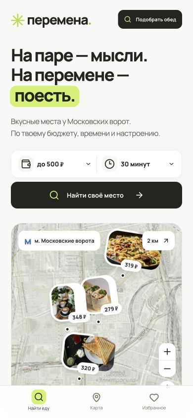

# Перемена

Рабочий мобильный сервис поиска еды в радиусе 2 км от м. «Московские ворота», Санкт-Петербург.

[Открыть сервис](https://peremena-moskovskie.violethero1.chatgpt.site) — доступ только аккаунту владельца.



## Что работает

- Подбор по стоимости блюда, длительности перерыва и кухне на сервере.
- Поиск по названию блюда, заведения и адресу; категории и избранное.
- Интерактивная карта OpenStreetMap с реальными адресами, масштабированием и границей радиуса.
- Карточка блюда с ценой, источником меню и переходом к пешему маршруту в Яндекс Картах.
- Публикация, изменение и удаление собственного отзыва к блюду. Средняя оценка рассчитывается по данным базы.
- Избранное в серверной базе. При входе привязано к аккаунту; без входа — к случайной HttpOnly-сессии этого браузера.
- Предложение нового места и список собственных предложений со статусом «На проверке».
- Адаптация под телефон, нижняя навигация, доступные формы, клавиатурная навигация, reduced motion.

Сайт опубликован закрытым: по просьбе владельца доступ разрешён только его аккаунту. Данные хранятся в Cloudflare D1, интерфейс и API работают на Cloudflare Workers через Sites/Vinext. Локальная база и размещённая база разделены; тестовые записи не переносятся в размещённый сервис.

## Данные и точность

Начальный каталог: 8 позиций, 4 адреса, 2 сети. Отзывы и рейтинги не выдуманы и изначально отсутствуют.

Источники, прочитанные 14.10.2026:

- [Меню ЦЕХ85](https://www.tseh85.ru/catalog): ролл с цыплёнком 279 ₽, паста Болоньезе с говядиной 319 ₽, соба с курицей и овощами 299 ₽, грибной крем-суп 239 ₽, сырники 189 ₽, капучино 229 ₽, классический круассан 119 ₽.
- [Адреса ЦЕХ85](https://www.tseh85.ru/shops): Заставская, 28; Заставская, 46, к. 1; Лиговский, 287. Координаты этих точек взяты из данных официальной страницы.
- [Сэндвичи буше](https://bushe.ru/products?category=sendvici&cityId=1): сэндвич с цыплёнком и овощами 320 ₽; цельнозерновой круассан с моцареллой 330 ₽.
- [Адрес буше](https://2gis.ru/spb/firm/70000001025846724): Московский, 139, к. 1. Координаты здания сверены с OpenStreetMap/Nominatim.

Капучино + круассан: 229 + 119 = 348 ₽, сумма двух товаров, не обещание акции. Это цены онлайн-меню сети, а не подтверждение цены и наличия в каждом филиале. Это явно указано в интерфейсе. Автоматической синхронизации с кассами и остатками нет. Для обновления начального каталога редактируйте `lib/catalog.ts` и публикуйте новую версию.

Радиус считается по геодезическому расстоянию от метро. Оценка пути: расстояние × 1,25 / 80 метров в минуту, округление вверх. Перерыв = путь туда + путь обратно + время на еду. Очередь и светофоры отдельно не рассчитываются. Для фактического маршрута используется внешняя ссылка Яндекс Карт. В интерфейсе расчётное время отмечено знаком ≈.

Фото еды иллюстративные: Unsplash и фотографии каталога ЦЕХ85. Фото студентов создано Image Gen и не является фотографией участников проекта. Изображение концепции: `docs/design-concept.png`.

Предложения мест сохраняются со статусом pending. Автоматической публикации непроверенных адресов нет; отдельная панель редактора в эту версию не включена. Владелец может просмотреть записи таблицы suggestions через инструменты базы Sites и после проверки добавить место в каталог.

## Запуск и Vercel

Требуется Node.js 22.13+. Стандартные команды теперь используют Next.js и создают `.next/routes-manifest.json`, который ожидает Vercel.

```sh
git clone https://github.com/grxnitt/food_moskovskie.git
cd food_moskovskie
npm ci
npm run build
npm start
```

Адрес локальной версии: http://127.0.0.1:3000/ . Для разработки: `npm run dev`.

Для API Next.js нужны серверные переменные `PEREMENA_BACKEND_URL` и `PEREMENA_BACKEND_TOKEN`. Они настроены в проекте владельца на Vercel. Для локального запуска создайте `.env.local` по образцу `.env.example` и укажите ключ только локально. Ключ нельзя публиковать в GitHub, передавать клиенту или добавлять префикс `NEXT_PUBLIC_`.

Интерфейс и API-слой Next.js работают на Vercel. Запросы к данным идут с сервера Vercel в существующий закрытый backend Sites / Cloudflare D1. База не заменяется локальным файлом или памятью функции. Без настроенного подключения API возвращает ошибку 503; фиктивных ответов нет.

Прокси передаёт только собственную cookie `peremena_session`, а не cookie авторизации Vercel или входящие заголовки идентификации пользователя. В браузере Vercel избранное и право изменять отзыв связаны с этой сессией. Каталог и опубликованные отзывы хранятся в общей D1. Правила закрытого доступа задаёт платформа Vercel; исходный сайт Sites остаётся закрытым.

`vercel.json` явно задаёт Next.js, `npm ci`, `npm run build` и `.next`. Подробности: [docs/vercel.md](docs/vercel.md).

### Нативный запуск Cloudflare / Sites

Исходные обработчики и миграции D1 сохранены. Отдельные команды для этого целевого окружения:

```sh
npm run build:sites
node --import ./scripts/sites-env.mjs ./node_modules/wrangler/bin/wrangler.js d1 execute DB --local --config dist/server/wrangler.json --persist-to .wrangler/state --file drizzle/0000_tearful_dracula.sql
npm run dev:sites
```

Миграцию применяют один раз к пустой локальной базе. Preview Sites: http://127.0.0.1:5173/ . Для собранного Worker: `npm run start:sites -- --port 5174`.

Локальная и размещённая базы разделены; применение локальной миграции не меняет размещённые данные. При наличии нативной привязки D1 сервер выполняет исходные обработчики напрямую. Next.js подменяет только модуль окружения Cloudflare на Node-адаптер, не импортируя `cloudflare:workers` в Vercel Functions.

## Проверки

```sh
npx tsc --noEmit
npm test
npm run build
```

Интеграционные тесты обращаются к работающему локальному серверу. Не направляйте их на пользовательскую рабочую базу: они создают и удаляют собственные проверочные записи.

API использует параметризованные запросы, проверку полей, ограничение размера тела, проверку Origin для записей и разделение пользовательских данных. Избранное идемпотентно. На один аккаунт/браузер допускается один отзыв к блюду с возможностью изменения.

Подробности визуальной и функциональной проверки: `docs/QA.md`.
